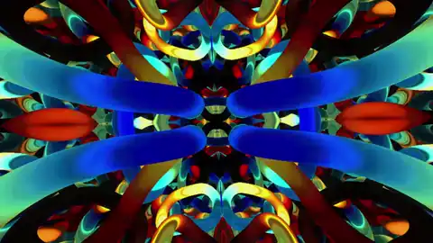
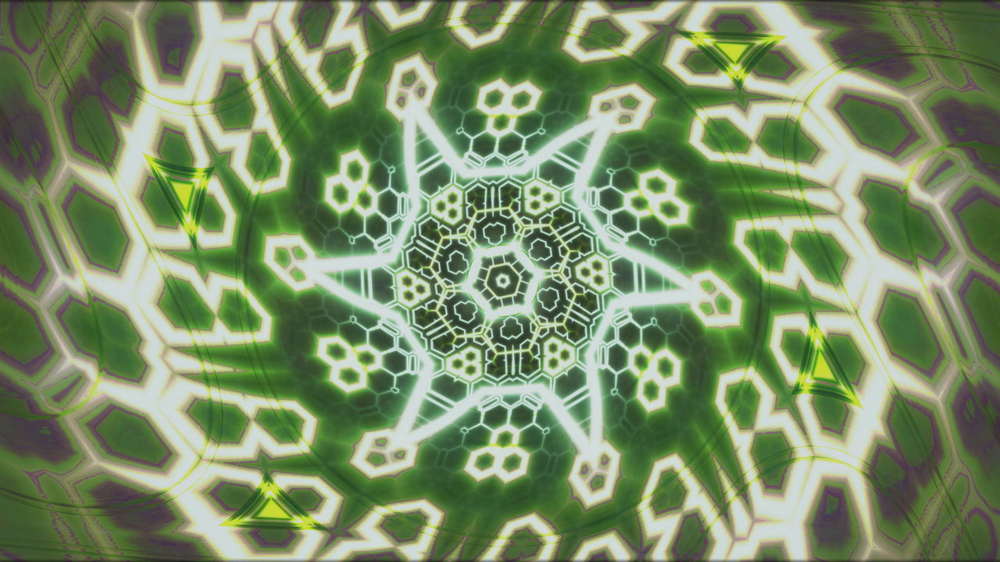
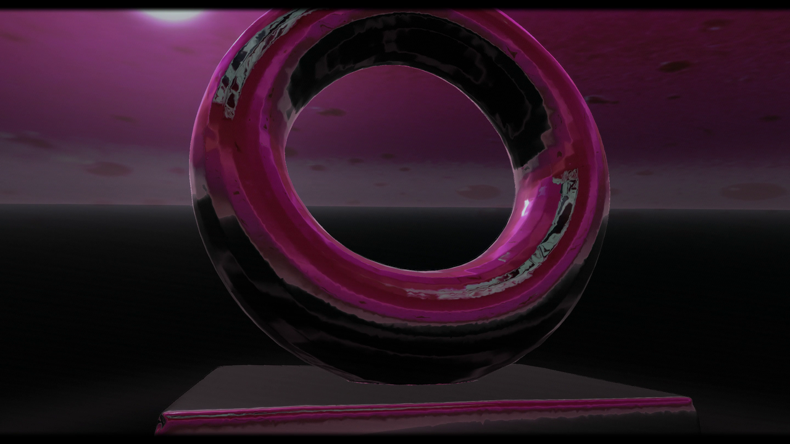
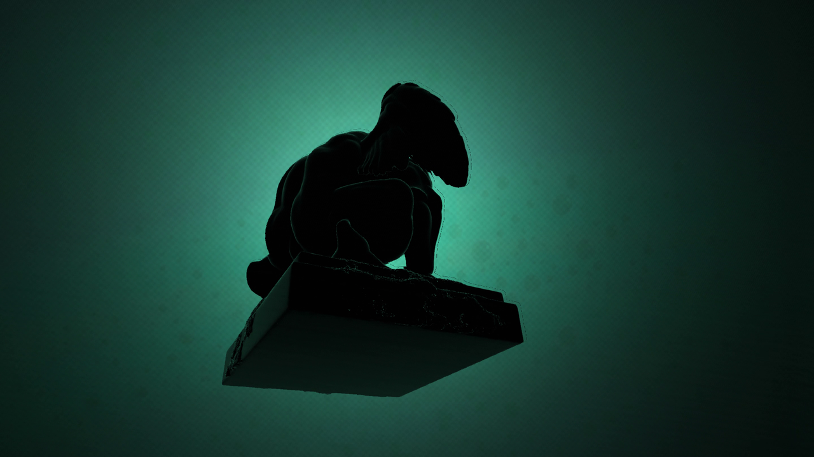
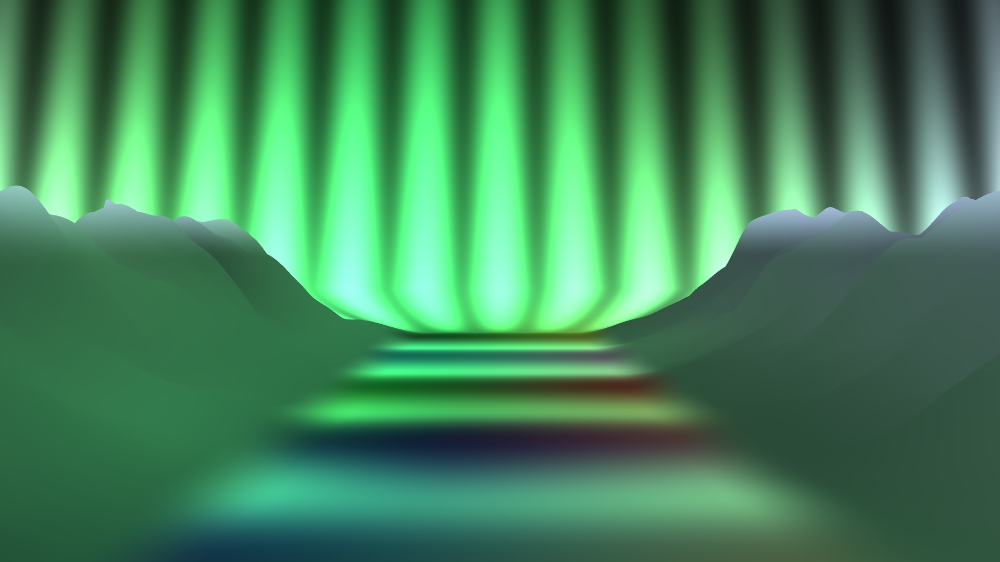

# Kaleidoscope Enhanced — Music Visualizer

[](LICENSE)
[](https://github.com/reneweller-coding/KaleidoscopeEnhanced/actions/workflows/ci.yml)


<br clear="left">

A real-time, audio-reactive kaleidoscope / tunnel visualizer for Windows and
Linux (since v1.20.0 the releases carry a Linux AppImage beside the Windows
builds, tested in the CI but not yet confirmed on real hardware; it also
compiles on macOS — see [Linux and macOS](#linux-and-macos)). It
listens to whatever is playing on the system (Spotify, browser, foobar2000,
a live mic, …), analyses it in real time, and drives a huge library of GLSL
shaders whose motion, colour and structure follow the music's rhythm, timbre
and mood — beat-driven Rock/Pop/EDM and beatless ambient/drone alike, calming
down automatically for speech.

**[⬇ Download the latest release](https://github.com/reneweller-coding/KaleidoscopeEnhanced/releases/latest)**
— no Qt / Visual Studio needed, just run the installer or unzip the portable
build. See [Quick start](#quick-start).



*Eight of the 2,475 scenes, three seconds each, rendered by the built-in video
export at a quarter of Full HD (`Tools/make_demo_clip.py`); the app itself
runs at the screen's resolution and frame rate.*

|  |  |
|---|---|
|  |  |
|  |  |

*Four of the 2,475 scenes in the [scene catalogue](docs/Catalog/Katalog.md) — a
photograph folded into a kaleidoscope, a loaded 3D model used as a mirror, one
used as a shadow puppet, and a hardware-tessellated fjord under the northern
lights.*

**Highlights**
- 2,475 scenes + 30 overlay effects + 210 scene transitions, all audio-reactive
  and image-driven — see the [scene catalogue](docs/Catalog/Katalog.md).
- Real signal analysis (beat/onset detection, key & mood, song-structure
  tracking) drives the visuals, not a generic FFT bar graph — see
  [how it listens to the music](docs/engine-internals.md).
- A photo library and 157 3D models it can fetch and install for you — see
  [Extra content](#extra-content-photos-and-3d-models).
- Synced lyrics, artist photos and the official music video can play alongside
  the visuals — see [Optional online features](#optional-online-features).
- Control it from a phone: a web remote with zero-config LAN pairing, plus an
  Android app — see [Remote control](#remote-control).
- Stereo-3D output, MIDI control, Spout output for OBS/VJ software, a German or
  English UI, and an unattended kiosk mode with a crash watchdog.

---

## Contents

- [Quick start](#quick-start)
- [Extra content: photos and 3D models](#extra-content-photos-and-3d-models)
- [Controls](#controls)
- [Mood detection, and OSC output for VJ tools](#mood-detection-and-osc-output-for-vj-tools)
  - [Score cues: letting a generator say where the bars are](#score-cues-letting-a-generator-say-where-the-bars-are)
- [Presets](#presets)
  - [Reviewing the shader library](#reviewing-the-shader-library)
- [Recording](#recording)
- [Video export](#video-export)
- [Setup tool](#setup-tool)
- [Remote control](#remote-control)
- [Optional online features](#optional-online-features)
- [Language](#language)
- [Build](#build)
- [Deployment](#deployment)
- [Project layout](#project-layout)
- [Credits and license](#credits-and-license)
- [Further reading](#further-reading)

---

## Quick start

[Download the latest release](https://github.com/reneweller-coding/KaleidoscopeEnhanced/releases/latest):
- **`KaleidoscopeVisualizer-Setup.exe`** — regular installer, Start-menu
  shortcuts for the visualizer, the Preset editor and the Setup tool. It
  installs for your user, without administrator rights, into
  `%LOCALAPPDATA%\Programs\KaleidoscopeVisualizer`, where the program can keep
  its settings; an older installation under Program Files is offered for
  removal, and its settings come along.
- **`KaleidoscopeVisualizer-portable.zip`** — unzip anywhere, double-click
  `Kaleidoscope-starten.bat`. No installation, nothing written outside the
  folder.
- **`Kaleidoscope-x86_64.AppImage`** — Linux (since v1.20.0), one file; see
  [Linux and macOS](#linux-and-macos).

The installer offers the photo and model packs as ticked options and installs
them for you; see [Extra content](#extra-content-photos-and-3d-models) for the
portable build and for pointing it at your own pictures. It runs without them
either way. Press **`h`** any time for the full keyboard reference in-app.

---

## Extra content: photos and 3D models

The scenes that fold photographs need photographs, and some scenes place a
**real 3D model** in the shot — a station against a nebula, a capital ship
making a slow pass, a chrome torus on a plinth. Both are **optional downloads**
rather than part of the installer: together they run to about 2.5 GB, thirty
times the program, and most of it is of no use to someone who only wants the
classic visualizer.

**The installer offers all four packs as ticked options and puts them in place
for you.** Afterwards — or for the portable build, which has no installer —
*Download extra content* in the [Setup tool](#setup-tool) does the same. By
hand: unpack into the program's `Images` and `Models` folders and restart
(with the Linux AppImage: `~/.local/share/KaleidoscopeVisualizer/Images` and
`…/Models`, see [Linux and macOS](#linux-and-macos)).

| Pack | | Contains |
|---|---|---|
| [Photos](https://github.com/reneweller-coding/KaleidoscopeEnhanced/releases/tag/images-v2) | 977 images, 593 MB | agate, rust, pigment, soap film, sediment, aurora, craquelure, woven fibre |
| [Models: ships](https://github.com/reneweller-coding/KaleidoscopeEnhanced/releases/tag/models-v3) | 77 models, 699 MB | capital ships, freighters, couriers, drones |
| [Models: stations](https://github.com/reneweller-coding/KaleidoscopeEnhanced/releases/tag/models-v3) | 30 models, 259 MB | space stations — the six station families |
| [Models: objects](https://github.com/reneweller-coding/KaleidoscopeEnhanced/releases/tag/models-v3) | 62 models, 517 MB | sculptures, hi-fi gear, sea creatures, eroded rock, gongs, pierced lattices, and the real-object scenes: rocket and pad, peacock, organ, aqueduct, bells, candles, gears, pendulums, metronomes, seismograph, foundry |

**Nothing breaks without them.** A scene whose model is missing is skipped when
the catalogue is read, the photo scenes fall back to a procedural texture, and
the startup log says how many and which folder it looked in. Once the models
are there, every genre preset simply has more scenes to draw from.

All of it is generated for this purpose, so there are no rights questions, no
faces and no recognisable subjects to be mangled by a mirror. The models were
mostly generated FOR the scene family that uses them, which is why the fit is
close: the resonant bodies are thin-walled because `ModalVibration` displaces
along a plate's thickness, and the pierced lattices exist because a shadow play
wants a complicated shadow.

**Your own pictures instead:** set **Photo folder** in the Setup tool. That
writes `imageDirectory` into `kaleidoscope_settings.ini`, which outranks the
presets — the right place for it, since `Presets\*.xml` are generated
and would lose the change. Subfolders are searched; `.jpg`, `.jpeg` and `.png`
are recognised. For one run only, `Kaleidoscope.exe -f <folder>` beats both.
What actually suits this program — format, tone, contrast, composition — is
written down in **[docs/photo-set-spec.md](docs/photo-set-spec.md)**, with a
checker that scores any folder against it (`Tools/check_image_set.py`).

**A photo's depth (in the works, November 2026).** Beside a photo folder, a
folder `.depth` may hold one grey depth map per photo (`<photo name>.png`,
white = near) and a table `photo_info.tsv`; `Tools/depth_maps.py` makes them.
The program loads a map with its photo (the walk never takes the maps for
photos) and hands it to the scenes; without maps everything looks as before.
For comparisons: `KALEIDO_NO_DEPTH=1` ignores all maps, `KALEIDO_DEPTH_DIR=<folder>`
takes the maps (and their `photo_info.tsv`) from one flat folder first,
`KALEIDO_SHOW_DEPTH=1` shows each scene's depth as a grey picture (white = near),
and `KALEIDO_DEPTH_RANGE=near,far` sets the distances a photo's depth is laid on
(default 8,80, the units of the 3D scenes). Seven transitions (`Transitions\Depth*.frag`:
from behind, fog wall, focus pull, layers, worlds merge, dusk, silhouette) move
through the depth of both scenes, and by brightness where a scene has none;
between two scenes with depth one fade in four takes one of them
(`KALEIDO_DEPTH_TRANS=0` leaves the roll alone).

Building the packs yourself, from folders you have filled:

```powershell
.\Tools\make_image_pack.ps1
.\Tools\make_model_pack.ps1
```

---

## Controls

| Key        | Action                                                        |
|------------|-----------------------------------------------------------------|
| `Q`        | Quit                                                          |
| `Esc`      | Quit **after asking** (closes the help box first if it is up) |
| `Enter`, `Menu` | Open the **on-screen menu** (remote control, see below) |
| media keys | `⏭`/`⏮` next scene, `⏯` freeze, `⏹` blackout              |
| `h`        | Toggle the on-screen **help** (keyboard reference)            |
| `0`        | Open/close the preset menu (see below)                        |
| `↑` `↓`    | Move the cursor in whichever overlay menu is open             |
| `Enter`    | Take the highlighted entry (cross-fades)                      |
| type       | Narrow an open menu to matching entries                       |
| wheel      | Scroll an open menu; click picks, click outside closes        |
| `i`        | Toggle the live audio-feature overlay (incl. **FPS**)         |
| `d`        | Choose the **audio source** (output / microphone) — overlay; remembered for the next start, and a capture on the default follows a new default output |
| `↑` `↓`    | Also drive the audio-source cursor while that overlay is open |
| `p`        | Toggle the **now-playing** track title display                |
| `w`        | **Lyrics** (Internet): off / credits scroll / karaoke — on by default |
| `Shift+w`  | Toggle the karaoke **kinetic line-slam** pop-in (off by default) |
| `o`        | **Artist images** (Internet): rotating inset + colour grade — on by default |
| `n`        | Manually advance to the next effect (musical scene change)    |
| `v`        | Show the active shader names (debug overlay)                  |
| `l`        | Toggle the **stage lamps / light show** (corner cones etc.)   |
| `[` / `]`  | Reactivity — less / more audio-driven motion                  |
| `,` / `.`  | Trails — shorter / longer feedback trails                     |
| `-` / `=`  | Mood — weaker / stronger colour grading                       |
| `;` / `'`  | Latency — visuals earlier / later vs. the heard beat          |
| `b`        | **Blackout** — soft fade to black and back (VJ)               |
| `e`        | **Freeze** — hold the picture (VJ)                             |
| `t`        | **Tap tempo** — tap the beat to override tempo detection      |
| `u`        | **Pin** — hold the current effect (no automatic switches)     |
| `f`        | **Favourite** the current effect (persistent selection bonus) |
| `Space`    | **Mark** / unmark the current scene (shortlist for review)     |
| `Shift+Space` | Save all marked scenes as the **Marked** preset             |
| `z`        | **Stereo 3D** — cycle off / side-by-side / top-bottom / anaglyph / full side-by-side / full top-bottom ([headsets](#stereo-3d-in-a-headset)) |
| `c` / `m`  | Stereo depth — weaker / stronger                              |
| `a`        | Toggle **auto-config-by-mood** (auto-switch configs)          |
| `g`        | Toggle **adaptive render scale** (auto-FPS)                   |
| `j`        | **MIDI learn** — bind knobs/pads to the controls; nothing is bound until learned. `midiDevice=<part of its name>` in the ini picks the device (the log lists them) |
| `r`        | Toggle **recording** (full render resolution → mp4)           |
| `y` / `x`  | Arm the **instant replay** ring / save it as an mp4           |
| `k`        | Save the current look **and** UI state as the startup default |
| `s`        | Save a PNG screenshot of the picture (no overlays) to `Pictures\Kaleidoscope` |
| mouse drag | (when not fullscreen) trackball / interaction                 |

### Remote control (HTPC)

Everything can also be reached from a hardware remote on a living-room PC.
Such remotes send ordinary keys: arrows, OK (Enter), Back (Back or Backspace),
Esc, usually a Menu key, and the media keys.

**OK** or the **Menu** key opens the on-screen menu, drawn large enough to read
from the sofa. `↑`/`↓` select a row, **OK** opens a submenu, runs an action or
flips a switch, `←`/`→` change sliders and choices (and `→` also opens
submenus), **Back** goes one level up, **Esc** closes it. It hides itself after
20 seconds without a key.

| Menu | Contains |
|---|---|
| Presets | every preset; the running one is marked, OK switches to it |
| Scene | next scene, hold scene, favourite, mark, save marked, never show again, undo favourite, forget this song's cues, banned scenes (each one allowed again with OK) |
| Picture & overlays | blackout, freeze, stage lamps, strict light protection, picture guard, 16-bit intermediates (from the next start), now-playing title, lyrics mode, line slam, artist images, music videos |
| Fine tuning | reactivity, trails, mood colour, latency (lead or delay) (sliders) |
| Audio | audio source, tap tempo |
| Stereo 3D | mode, depth |
| Automation | pick preset by mood, adapt resolution, rest after silence (off/5/15/30/60 min), sleep timer (off/15/30/60/90 min) |
| Capture | record, instant replay armed / save, screenshot |
| Info & diagnostics | shader names, audio analysis + FPS, keyboard shortcuts, the remote's address (OK shows its QR code), mesh scenes skipped for missing models |
| System | language, save settings as default, install update (when one is found), quit |

The menu works on the same state as the keys and the web remote, so all three
always agree. `Esc` outside the menu asks before quitting, because on a remote
it sits right next to Back; `Q` on a keyboard still quits at once. The keyboard
shortcuts all stay as they were -- the menu is for the remote, the letters are
for debugging and live work.

A key whose effect cannot be seen says what it did in a short line at the
bottom of the picture: preset by mood, adaptive resolution, hold scene,
latency, saved as default, favourite (with the taste it has now), tap tempo,
stereo, the overlays' switches, the screenshot's file -- and why `n` did
nothing when the scene is held or frozen. MIDI learn shows its target until it
is learned. `keyFeedback=false` in the ini keeps them in the log only. The key
help (`h`) is sized by the window and breaks into two columns when it has to.

**Never again.** A scene you do not want in a preset is banned from the menu
(Scene) or the remote (it stays out of the rolls for good; a song cue, a jump
from the browser or a section replay can still show it). The banned scenes are
listed in the menu and dimmed in the remote's browser, and one press allows a
scene again. Enough stays in: a ban that would leave fewer than twelve scenes
(or a twentieth of the preset) is refused. The favourite can be taken back,
and the cues a favourite pressed during a song set can be forgotten.

**Light protection.** The brightness limiter holds how fast the picture's mean
may rise; since 16.10.2026 it also watches the picture in cells: when a quarter
of the frame flashes three times a second or more -- the threshold of the
photosensitivity guidelines, which a steady mean of two halves flashing against
each other never showed -- the picture dims to 60 % until it stops. The strict
mode (menu, Setup tool, `lightProtectionStrict=true`) halves the rise and takes
the beat flashes out of the stage lamps and the title.

**Picture guard.** On by default (since 27.11.2026; switch it off in the menu
Picture & overlays, on the remote's Display tab or with `pictureGuard=false` in
the ini), it watches for a picture that stays black
or stands still while music plays: 20 seconds of it and the next photo fades in
(within 4 s; a dark photo is the usual cause), 15 more and the scene ends early
-- on the phrase where the beat grid is known, with the preset's own fade. It
never acts during a blackout, a freeze or a pin, a DJ stop, a scene fade, a
song's fade-out, the rest mode or silence, and not on the rating walk. The
darkest scenes by design stay well above its threshold (see
docs/engine-internals.md, section (69), for the measurement). What it did is counted
per scene and per photo in `kaleidoscope_guard.tsv` beside the settings file
-- it does not change the taste; whether the counts should steer the choice is
up to you. Each action is one log line (`GUARD photo dark scene=...`), which
`python Tools/guard_report.py kaleidoscope.log` lists. For tests:
`KALEIDO_GUARD=1` switches it on even in scripted runs and exports,
`KALEIDO_GUARD=log` only says what it would do, `KALEIDO_GUARD=0` keeps it off,
`KALEIDO_GUARD_LOG=1` adds a line a second with what it sees, and
`Tools/guard_run.py` runs it over hours of music as video exports.

**Latency: the picture and the sound you hear.** The loopback hears the music
the moment the program hands it to the sound card; Bluetooth headphones play it
150-250 ms later, a television 50-150 ms. `latencyLead` (keys `;` and `'`, the
menu, the remote's slider) is one setting with a sign: above zero it leads the
beat phase as before (default +50 ms, for speakers on a cable), below zero --
down to -500 ms -- it delays every audio feature: levels, beats, onsets,
tempo, sections and drops all arrive that much later, and so do the score cues
of a generator and what the scheduler times by the phrase. A video export is
never delayed (its audio is a file), a recording shifts its sound by the delay,
so it stays in sync, and the OSC output follows the picture. To set it, switch
on the **calibration ring** on the remote (Live tab): it closes on every beat
the picture plays and its dot lights with every kick; move the slider until both
land on the beat you hear (picture too early: towards minus). **Tap along** on
the remote gives a start value: tap the pad in time with what you hear; the
taps are measured against the loopback's own beat grid, and since people tap
some tens of milliseconds ahead of a beat (Repp 2005), 30 ms are added back.
A phone's touch screen adds its own latency, so take the value as a start, not
as the answer. `KALEIDO_LATENCY=<seconds>` sets it for one run without touching
the ini.

**Both overlay menus** — the preset picker (`0`) and the audio-source picker
(`d`) — scroll, so they reach entries the digit keys cannot. Anything past
the ninth used to be unselectable, and in the audio menu it was not even
drawn: the hidden-preset debug switch and a saved `Marked` preset both push
the preset list past nine, and a machine with a few virtual audio cables has
well over nine sources. Each opens on the entry that is currently in use, `↑`/`↓` (plus `PgUp`/`PgDn`/`Home`/`End`) move the cursor,
`Enter` selects, and `Esc` (or `0` / `d`) closes without changing anything.
The highlight bar is where `Enter` would take you; the marker shows what is
actually in use.

Typing narrows a menu to entries containing what you typed — useful once the
device list runs past twenty. `Backspace` takes a character back, `Esc` clears
the filter first and closes on the second press. The mouse works too: the wheel
scrolls, a click takes an entry, a click outside closes.

`1`–`9` used to jump straight to a preset and are now unbound: the menu reaches
every entry, so nine keys no longer have to be spent on a shortcut that only
covered part of the list.

**Double-click** toggles fullscreen. It used to quit the app outright, which
made a slip of the hand end the show; quitting is `Esc` or `q`.

Press **`k`** to persist the tuning keys (plus render scale) to
`kaleidoscope_settings.ini`, so they're restored next launch. The `i`
overlay shows the current FPS — handy for tuning render scale on a target
machine.

One key in that file has no hotkey: `calmMotion` (default `true`) keeps the
host's virtual camera completely still — no downbeat punch-in, no kick shake,
no bar sway, no drop rewind, no bass shockwave, no beat-pumped trail warp.
It is on by default because whole-frame jolts make some viewers ill; set
`calmMotion=false` for the older, livelier camera.

---

## Mood detection, and OSC output for VJ tools

The analyzer estimates the music's mood on Russell's two axes — valence
(positive/negative) and arousal (calm/energetic) — and uses it everywhere:
scene selection is biased toward matching mood tags, pacing follows arousal,
and a global colour grade follows the empirically grounded mapping canon
(happy = warm and vivid, sad = bluish and muted, dissonant = harder edges).
Every ingredient was measured against an 80-track corpus rather than guessed.

Other software can consume the analysis live: set `oscPort` in the settings
(or the Setup tool) and the visualizer streams OSC/UDP — `/mood/valence`,
`/mood/arousal`, `/mood/quadrant`, `/beat`, `/audio/bands`, `/tempo/bpm` and
more — to TouchDesigner, Resolume, Max/MSP or anything else that speaks OSC.
The show's state goes along: `/scene/name`, `/preset`, `/transition/start`,
`/blackout`, and `/color/mean` — the picture's mean colour for lights that
follow the image, held to the same brightness-rise limit as the picture.

The full story, with the literature and the measurements, is in
[docs/mood-and-mapping.md](docs/mood-and-mapping.md).

### Score cues: letting a generator say where the bars are

Everything above is an *estimate* of music the visualizer only ever hears. A
software generator playing its own composition does not have to be guessed at:
it knows the bar line exactly and it knows a drop is coming before it lands. If
one is driving the sound, it can say so over OSC/UDP, and the scheduler stops
guessing:

```ini
[General]
cuePort=9000
cueBind=0.0.0.0
```

`cuePort=0` (the default) means the feature is off and nothing listens.
`cueBind` is the interface — `127.0.0.1` for a generator on the same machine,
`0.0.0.0` to let one on the LAN (a headset, say) reach it.

Five messages are understood, and nothing else on that port is acted on:

| message             | effect                                                   |
|---------------------|----------------------------------------------------------|
| `/phos/bar i`       | the bar line a due scene change is quantized to           |
| `/phos/beat i`      | keeps the time (tempo and beat phase); never causes a cut |
| `/phos/section s f` | a section starts (type and energy 0..1) → a scene change  |
| `/phos/drop`        | a drop lands on this instant → a hard cut                 |
| `/phos/key s`       | the key from here, e.g. `F# Phrygian`                     |

**An external clock.** Beat cues keep the time: while they come, tempo and
beat phase follow them (as a tap that keeps tapping), and two seconds after the
last one the analysis takes over again. MIDI clock from a DAW or a DJ program
does the same on the MIDI input (`midiDevice`): the tempo from its ticks, the
phase once Start or a song position has said where the song is. Both arrive
before the sound the visualizer hears; `clockDelay` (seconds, default 0.06)
places the beat that much later. `externalClock=false` leaves the time to the
analysis alone.

The cues feed the same two rising-edge triggers the audio analysis has always
fed, so everything that guards them still guards them: a cue that lands during
a cross-fade cannot retarget it, a cut still has its minimum solo, and camera,
zoom and rotation remain untouched by anything the music does. If the sender
stops — or was never there — the audio analysis takes over again after two
seconds and the program behaves exactly as it did before. `Kaleidoscope.exe -q`
checks all of that and exits 0 or 1, without opening a window.

The sender this was built for is the Phosphene psytrance generator (its
`docs/PLAN.md`, section 8.3); the wire format is plain OSC 1.0, so anything
that can send those five messages works. The rest of its family is understood
in its own words as well: Totality (`/tot/...`), Parhelion (`/parh/...`),
Ephemeris (`/eph/...`) and Noctuary (`/noct/...`) -- their blocks, phases and
scenes become sections, their Camelot keys keys, a Return, a Drop or a PEAK a
drop (`Source/CueReceiver.h` has the table).

**From a file, for a batch render.** A rendered track can carry its cues in a
text file instead: one message per line, tab-separated — the second in the WAV,
the address, the arguments (`#` starts a comment):

```text
0.000	/phos/key	F# Phrygian
0.000	/phos/section	Intro	0.20
0.000	/phos/bar	0
59.077	/phos/section	Drop	0.90
59.077	/phos/drop
```

`Kaleidoscope.exe -x track.wav -k track.cues.tsv` then renders the video with
every cut placed by the score: each cue goes in when the WAV reaches its time.
The demo videos of the VRAudio generators (Noctuary, Ephemeris, Phosphene,
Totality, Parhelion) are made this way; their `Tools/demo/make_demos.py`
writes the file from what each generator's renderer knows about its track.

## Presets

`Presets\*.xml` define which shaders are in rotation, their
probabilities, mood tags, and the photo folder (`ImageDirectory`, shipping as
`..\Images`) they draw on. These files are GENERATED, so change the folder in
the Setup tool rather than in here — see
[Extra content](#extra-content-photos-and-3d-models). Switch between them in
the preset menu (`0`) or from the remote. Included presets, one per kind of
music, each with at least 400 scenes picked by a rating of how well they fit:

- **Allround** — everything, balanced; a safe default
- **Ambient** — music without a beat: calm drift, fluid ink, lava, slow light
- **Downtempo** — the slow beat (chillout, trip-hop, lounge): warm, flowing,
  colourful
- **SpaceAmbient** — sci-fi & deep space: starships, planets, space
  stations, nebulae, black holes, alien worlds
- **Cinematic** — classical, film music, piano: landscapes, architecture,
  painting and slow flights, with long scenes and long fades
- **Club** — aggressive & bright: tunnels, godrays, lattices, analyzers
- **Electronic** — the synthetic look for techno and electronica: grids, lasers,
  neon, spectra, data streams, hard geometry
- **Psytrance** — the driving psychedelic look: tunnels, fractal flights,
  kaleidoscopes, hard patterns
- **Psychedelic** — breathing fractals, pills, chrome, plasma, mushrooms
- **Noir** — dark, high-contrast: noir fractals, dark tunnels, deep drones
- **Komplett** (hidden) — every scene and overlay in one rotation: the master
  list the other presets are generated from, and where the editor starts

Every scene re-rolls its own parameters each time it's picked, so one
shader yields many different looks over a session rather than repeating
itself identically.

**[Browse the full scene catalogue](docs/Catalog/Katalog.md)** — all 2,475
scenes, 30 overlay effects and 210 transitions, each with a description and
three example frames. A printable `Katalog.pdf` ships with every release.
The same catalogue as a page with search and filters by kind, genre preset
and mood is online at
**[reneweller-coding.github.io/KaleidoscopeEnhanced](https://reneweller-coding.github.io/KaleidoscopeEnhanced/)**
(the file is [`docs/Catalog/index.html`](docs/Catalog/index.html); it has no
dependencies and also opens from a clone without a server). Every entry has
its own link (the page address with `#SceneName`, e.g.
[`#TunnelPlain`](https://reneweller-coding.github.io/KaleidoscopeEnhanced/#TunnelPlain)),
the arrow keys page through the current selection, and "Random scene" picks
one from it. It also lets you mark what you like and what you do not;
`Tools/apply_taste.py --ratings` folds an export of those marks into the
genre presets.

**Building your own presets:** `PresetEditor.exe` (its own small Qt app,
bundled with every release) edits `Presets\*.xml` with a live shader
preview — browse every scene, add it to a preset with its timing/probability,
tune per-parameter ranges against a real preview, and save. It also carries
the project's self-tests (`--validate`, `--roundtrip`, `--transcheck`,
`--render`) used to catch broken presets and transitions before they ship.
Build it with `msbuild PresetEditor\PresetEditor.vcxproj /p:Configuration=Release /p:Platform=x64`.

A handful of shaders (`ChromeDreams`, `DiscoGodrays`, `FlowingWires`,
`FractalBloom`, `InsideSystem`, `NeonTubes`, `PsychedelicPills`, `SphereGrid`,
`TheCore`, `Vortex`, `Voyager`) are adapted from community shaders by
[kishimisu](https://www.shadertoy.com/user/kishimisu) on Shadertoy, CC
BY-NC-SA 4.0 — see [Credits and license](#credits-and-license).

---

### Reviewing the shader library

When you want to look *at* the shaders rather than enjoy them, play
`Komplett` (start it with `-c Komplett`, or show hidden presets) and mark what
you see. A preset whose name starts with `Test` switches the engine into
review mode: every scene in a fixed order (2D alphabetically, then 3D), 25 s
each. The checked-in bench `TestAlle` was retired in v1.18; make your own by
copying a preset under such a name.

* **Marking** — press `Space` while a scene is up to shortlist it, and
  `Shift+Space` to write every marked scene to `Presets\Marked.xml` as
  a playable preset. Both are on the [remote](#remote-control) too, so you can
  mark from a phone while the show runs on a TV. Marks live in
  `kaleidoscope_settings.ini` and survive restarts, so an inspection pass can
  span several sessions. The `v` overlay shows whether the current scene is
  marked.

So: run `Komplett`, tap `Space` on anything that looks wrong, then
`Shift+Space` and switch to `Marked` to work through the shortlist.

## Recording

Recording captures at the **full render resolution** (not a fixed 720p) and
encodes once, in hardware where available: raw frames are piped straight into
a running `ffmpeg`, and on stop the video is copied into the container beside
the audio rather than re-encoded. `ffmpeg` must be on the `PATH`; without it
the recorder falls back to writing JPEG frames plus a `make_video.bat` you can
run by hand.

The encoder is probed at runtime, preferring the discrete GPU's block, then
Intel Quick Sync, then software. The output codec defaults to **H.264** —
the one every player and editor opens — and can be changed in the Setup tool
or via the `videoCodec` key in `kaleidoscope_settings.ini`:

| `videoCodec` | Notes |
|---|---|
| `h264` (default) | Plays everywhere |
| `hevc` | Roughly 2.5–3× smaller at the same quality; needs the HEVC extension on Windows |
| `av1` | Smallest in principle, but on NVIDIA hardware HEVC beat it on both size and quality in our measurements |

If the requested codec has no working encoder on the machine, it says so and
falls back to H.264 rather than failing the recording. `KALEIDO_VIDEO_CODEC`
overrides the setting for one run, `KALEIDO_VIDEO_ENCODER` forces one specific
encoder (still verified before use).

---

## Video export

`KaleidoscopeExport.exe` (Start-menu shortcut **Video-Export**, or
`Video-Export-starten.bat` in the portable build) turns an audio file into a
video of the show: pick a preset and a file — WAV, MP3, OGG, FLAC or anything
else ffmpeg reads — choose **Full HD or 4K** and **24, 30, 60 or 120 frames
per second**, and it writes an MP4 with the audio in it — named like the audio
file and beside it unless you choose otherwise. The file can simply be dragged
onto the window.

An export is not a recording of the screen. The engine runs on a **frame
clock**: frame *n* shows the show at exactly *n / fps* seconds however long it
took to render, so the frame rate is constant by construction — a shader
compile or a model load costs render time, never picture — and it runs as
fast as the GPU and the encoder allow. On an RTX 5090, Full HD at 60 fps
renders at about 4× real time, 4K at 60 fps at about 2×. The music is analysed
block by block exactly as far as each frame, by the same analyser the live
show uses, and the look is the one `kaleidoscope_settings.ini` describes
(reactivity, trails, mood, …). An export writes nothing back to it.

| Option | |
|---|---|
| Codec | *Automatic* takes H.264 up to Full HD (plays everywhere) and H.265 above (half the size at 4K); AV1 for newer devices |
| Quality | *Highest*, *High*, *Compact* — constant-quality levels of the encoder |
| Fade | in from black over the first second, out over the last two (on by default) |
| Title | weaves the file's title and artist tags in at the start — the live show's title reveal |
| Motion blur | renders at 120 Hz and averages the sub-frames of each frame, like a camera shutter: smoother at 24 or 30 fps, but 120 frames to render per second of video |

ffmpeg is required and not bundled: the tool looks on the `PATH` and in the
usual package-manager folders (winget, scoop, chocolatey), takes the newest
and shows which; `winget install Gyan.FFmpeg` installs one. The export also
runs from the command line:

```
Kaleidoscope.exe -c Psychedelic -e track.flac -g 3840x2160 -p 60 -j hevc,title -d video.mp4
```

`-e <audio>` exports that file, `-g <WxH>` sets the size (`fullhd` and `4k`
work too), `-p <fps>` the frame rate, `-d <file>` the output (default:
`<audio name>.mp4` beside the audio), and `-j` takes a comma list
of `h264`, `hevc`, `av1`, `blur`, `nofade`, `title`, `q=max|high|compact` and
`cq=N`. A score-cue file (`-k`) works as in a batch render. The window shows a
preview; Esc, closing it, or `quit` on stdin finishes the file with the frames
so far. Exit code 0 done, 1 cancelled, 2 error; the progress comes as
`[export] progress <done> <total> <seconds> <speed>` lines on stderr.

With `-3` the video is a stereo video (see [Stereo 3D in a headset](#stereo-3d-in-a-headset)).

Build it with `msbuild ExportTool\ExportTool.vcxproj /p:Configuration=Release /p:Platform=x64`.
How the frame clock works, and what the encoder settings are based on:
[docs/engine-internals.md](docs/engine-internals.md#16102026-4-video-export-on-a-frame-clock).

### Glow from real brightness (16-bit intermediates)

Every intermediate picture is rendered at 16 bit (RGBA16F) instead of 8: light above white -- particle swarms,
lasers, sparks, lamp cores -- survives to the glow instead of being cut flat, and the final picture rolls it off
softly. On by default since 27.11.2026. It costs some 0.1–0.4 ms of GPU time a frame and about 330 MB of GPU memory
(measured on an RTX 5090 at 2880 x 1620). The photosensitivity limiter keeps measuring what you see.

To switch it off -- an older graphics card short of memory, or for the old 8-bit picture -- untick *16-bit
intermediates* in the Setup tool, in the menu (Picture & overlays) or on the remote (Image & 3D), or set
`hdrBuffers=false` in `kaleidoscope_settings.ini`. The targets are made when the program starts, so the change
applies at the **next start**. `KALEIDO_HDR_BUFFERS=0` or `=1` overrides the setting for one run (for tools and
comparisons). Where the driver cannot render into 16-bit targets, the program falls back to 8 bit by itself and says
so in its log (`Intermediate pictures: RGBA16F targets incomplete ... -- 8 bit`). The rewind history stays 8 bit:
in a rewind, light above white shows as white. Details: docs/engine-internals.md, sections (69) and (70).

### Kick, snare and hi-hat

Since 27.11.2026 the scenes' `audioHat` follows the hi-hat itself: the analysis splits each onset onto drum templates
(Source/DrumSeparator.h), so a lead melody no longer flashes the hi-hat. `audioKick` and `audioSnare` keep the earlier
band-group onsets by default -- the separator's kick and snare did better on synthetic music but not on a real drum
kit. `KALEIDO_OLD_DRUMS` chooses: `1` all three as before, `0` all three from the separator, or the drums named
(`kick,snare` is the default). Details: docs/engine-internals-70-analyzer.md.

---

## Stereo 3D in a headset

The show can be watched in 3D: a 3D scene is rendered once per eye (real
geometry, real depth), a 2D scene gets its depth from the picture (bright
structures come forward, the centre of a tunnel recedes). The formats, with
`-3 <mode>`, the `z` key, the menu (Stereo 3D) or the remote's *Image & 3D* tab:

| Mode | Picture | For |
|---|---|---|
| `sbs`, `tb` | both eyes squeezed into the normal frame ("half") | 3D TVs and projectors, players that expect half SBS |
| `fsbs`, `ftb` | each eye at the full frame size, the picture **twice as wide / high** ("full") | headsets: twice the detail per eye |
| `ana` | red/cyan in one picture | anaglyph glasses |

`c` / `m` (or the remote's slider) make the depth weaker or stronger. With
the same proportions per eye, half and full show the same depth (the same
disparity as a share of the eye's width); full only adds detail. A fade between a 3D and a 2D scene keeps
the 3D scene's depth until it is gone (`Tools/stereo_disparity.py` measures
all of it on a test scene with known depth).

**Live, on a virtual screen.** Any app that puts the PC's desktop on a big
screen in the headset and can show it as side-by-side 3D (Virtual Desktop,
Bigscreen, Immersed and the like) works: run Kaleidoscope fullscreen (`-b` or
double-click), set the stereo mode, and switch the app's screen to SBS 3D.
Take `sbs` (half) when the app splits a normal 16:9 desktop into two
squeezed eyes, and `fsbs` when it shows a double-wide desktop as full SBS
(each eye gets half of the window's width at full height, so a 32:9 or
doubled virtual monitor is what it is made for; on a 16:9 window each eye
is a narrow 8:9 picture).

**As a video.** The export keeps the stereo mode, and `-g` is the size of
**one eye** in the full formats:

```
Kaleidoscope.exe -c Ambient -e track.flac -g 1920x1080 -p 60 -3 fsbs
```

writes `track_SBSF.mp4`, 3840 x 1080 with the audio. The default file name
carries the tag players read the layout from: `_SBS` / `_TB` for the half
formats, `_SBSF` / `_TBF` for the full ones. DeoVR finds SBS and TB anywhere
in the name ([its documentation](https://deovr.com/doc), section 10);
HereSphere reads `_sbs` as side-by-side and `_SBSF` (or `_LRF`) as *full*
side-by-side (its developer on itch.io). `_TBF` follows the same pattern but
neither player documents a tag for full top-bottom -- choose the layout in the
player if it does not switch by itself. A name given with `-d` is used as it is.
Copy the file to the headset (USB, or stream it from the PC with the player's
DLNA/SMB support) and play it as a flat screen in 3D.

Sizes, measured with the export's encoders on an RTX 5090 (60 fps):

| Per eye | Video | Encoder (automatic) | Level |
|---|---|---|---|
| 1920 x 1080 | 3840 x 1080 (full SBS) or 1920 x 2160 (full TB) | H.265 | 5.0 (H.264: 5.1) |
| 2560 x 1440 | 5120 x 1440 | H.265 (H.264 cannot go wider than 4096) | 5.1 |
| 3840 x 2160 | 7680 x 2160 | H.265 or AV1 only | 6.1 |

2 x 1440p is the largest sensible size: at level 5.1 it is about the pixel
rate of 4K at 60 fps, which a headset that plays 4K60 video decodes. 2 x 2160p
needs a level-6 (8K) decoder -- fine for a PC player, too much for most
standalone headsets.

---

## Setup tool

`KaleidoscopeSetup.exe` (Start-menu shortcut **Setup**, or
`Setup-starten.bat` in the portable build) is a small standalone editor for
`kaleidoscope_settings.ini` — the optional extras have grown numerous enough
(lyrics, artist images, music video, language, web-remote port, render
tuning, …) to deserve a proper on/off panel instead of hunting through
keyboard shortcuts. Changes are saved to the same settings file the main app
reads on startup and take effect the next time it launches, except the
language dropdown, which retranslates the Setup tool's own form immediately
so you can see the result before saving.

**Download extra content** lives here: tick the photo pack and whichever model
packs you want, and it fetches them from the release page and unpacks them
into `Images\` and `Models\`. Packs already on disk show as installed and are
unticked, so a second visit does not propose re-downloading two gigabytes.
This is the portable build's route to them, since it has no installer.

**Photo folder** lives here too, and this is the only sensible home for it:
the presets carry a default (`..\Images`) but they are regenerated from the
catalogue, so a path typed into them would not survive. Leave the field empty
for the bundled images.

**Debug: show hidden presets** puts the `Komplett` master back into the menu
and into the remote, so you can reach it without a command line. It is out of
the way by default because it is a reference catalogue, not something to land
on while enjoying the show. The same switch is one line in the ini if
you would rather not open the tool:

```ini
[General]
showHiddenPresets=true
```

**Rest after silence** (Setup tool, or `idleMinutes` in the ini; off by
default): after that many minutes of *digital* silence — every band below
about −60 dB, so a quiet drone or a spoken passage never counts — the picture
fades to black, the scenes stop and the window redraws five times a second.
A second of sound, a key or a remote action brings it back with a fade.
`idleDisplayOff=true` also lets the display sleep while resting; many
projectors fall into standby without a signal and wake only with their own
remote, hence off. The **sleep timer** in the menu dims the picture over its
last two minutes and then rests the same way, until a key or the remote.

**Half the panel's rate** for long shows on a shared GPU: `frameDivisor=2` in
the ini renders every second refresh (60 fps on a 120-Hz panel). Trails and the
simulations follow the frame time, so the picture moves the same, in fewer
frames.

> The settings file is resolved **relative to the working directory**, one
> level up from the exe: `Release\Kaleidoscope.exe` reads the copy in the
> repository root, the packaged `bin\Kaleidoscope.exe` the one in the
> package root. A copy sitting next to the exe is never read. The startup
> log names the file it actually used (`Settings: <full path>`), so check
> there first if an edit seems to have no effect.

Build it with `msbuild SetupTool\SetupTool.vcxproj /p:Configuration=Release /p:Platform=x64`
(no GL/audio dependency — a plain Qt Widgets app).

---

## Remote control

A phone-friendly **web remote** (`-t <port>`, on by default at
`http://<pc>:8080/`) gives you a live preview image, preset buttons,
next-effect, blackout, favourite, mark/save-marked, replay, a scene browser you can tap
straight into, and sliders for reactivity/trails/mood/latency — plus all the
toggles from the Setup tool (lyrics mode, artist images, music video,
auto-preset, auto-scale, …). LAN convenience only — no auth, don't expose it
to the internet. Other web pages cannot drive it: an action needs the header
`X-Kaleido: 1` (the page and the app send it; a script calling `/api/...` must
too), reading the state and the preview does not, and a request has to name
this PC — an IP address, `localhost` or its own name — as its host.

**Finding it:** the menu's Info page names the address(es) a phone reaches it
at -- the PC's real network adapters, cable first, never a VPN tunnel or a
virtual switch -- and OK on one shows a card with its QR code: point the
phone's camera at it. The very first start shows the card by itself. The
remote's screenshot button saves the picture and shows it on the phone.

**Rating scenes from the sofa:** the remote's **Rate** tab walks the scenes of
the running preset that have no verdict yet, one after the other, each for the
seconds you set (3-60, short cross-fades, no musical cuts in between), with three
big buttons: **Like** (a favourite), **Next** (seen, no opinion) and **Never
again** (banned in this preset). A counter shows how far you are ("312 of 823
rated" -- the models of one 3D family share a shader and count once). A scene you
leave without a verdict moves on when its time is up and comes round again
later; **Undo** takes the last verdict back and shows the scene again. The
verdicts are kept in `kaleidoscope_settings.ini` (`[rated]`, next to the
favourites and bans they also make), so the next walk skips them, and
`python Tools/apply_taste.py --write` folds them into the shipped presets.

**Zero-touch pairing:** the running instance broadcasts itself on the LAN
(UDP discovery), so a client never needs the PC's IP typed in by hand.
Several PCs or several instances on one PC show up as a picker.

**Android app** (`AndroidRemote\`, [build instructions](AndroidRemote/build-apk.ps1))
wraps the same remote in a fullscreen WebView with its own icon and
auto-discovery — no typing an address, and it never needs updating when the
remote grows new controls, since all the logic lives on the PC. Requires
Android 8.0+; allow `Kaleidoscope.exe` through the Windows firewall
(private networks) the first time so the phone can reach it.

---

## Optional online features

All on by default, all individually switchable from the [Setup tool](#setup-tool)
or the web remote, all cached locally so a repeat play needs no network:

- **Now playing (`p`):** the track title/artist is woven through the picture
  with one of 24 reveal styles, matched to the music's mood. Reads the
  Windows system media session (Spotify, browsers, most modern players);
  foobar2000 needs its free *Media Controls* component; VLC is read from its
  window title as a fallback.
- **Lyrics (`w`):** synced lyrics fetched from a fallback chain of free
  services (no API key), shown as a scrolling credits band or karaoke-style
  with the active line highlighted.
- **Artist images (`o`):** photos of the current artist, fetched and
  deduplicated from a few free services, rotating as a small inset with a
  colour grade pulled from the image.
- **Music video:** for tracks under 20 minutes, the official video is
  searched on YouTube (matched by duration and channel, official-video
  scoring) and, if found, downloaded once via [`yt-dlp`](https://github.com/yt-dlp/yt-dlp)
  and played in sync in the same corner artist images use. Needs `yt-dlp` on
  `PATH`; the app runs normally without it, it just skips this one feature.

---

## Language

The UI (on-screen overlays, the web remote page, the Setup tool and the video
export tool) speaks German or English, switchable from a dropdown in the Setup
tool. Until you choose, it follows the system: German on a German Windows (the
display language decides), English everywhere else. Nothing is written into
your settings file for that, so it keeps following the system until you pick a
language yourself. The Android app isn't part of that switch; it follows the
phone's own system language, the standard Android behaviour.

---

## Build

Windows is the reference build and the only one the releases are made from. Linux and macOS build from CMake; see below.

**Requirements**
- **Qt 6.11** (kit `msvc2022_64`), installed at `C:\Qt\6.11.1\msvc2022_64`
- **Visual Studio 2026** (or 2022) — platform toolset **v145**, target **x64**

**Visual Studio:** open `Kaleidoscope.sln`, select **Release | x64**, build.
`QTDIR` defaults to `C:\Qt\6.11.1\msvc2022_64` (set in the project); override
it if your Qt is elsewhere.

**Command line**
```powershell
$env:QTDIR = "C:\Qt\6.11.1\msvc2022_64"
cmd /c '"C:\Program Files\Microsoft Visual Studio\18\Community\VC\Auxiliary\Build\vcvars64.bat" && msbuild Kaleidoscope.vcxproj /p:Configuration=Release /p:Platform=x64'
```

**Qt Creator** — `Kaleidoscope.pro` mirrors the VS project, so the code can
also be browsed and built from Qt Creator with a Qt 6 / MSVC kit; the VS
project remains the primary build (it also runs the auto-deploy).
`python Tools/check_build_lists.py` keeps the `.pro` and `CMakeLists.txt` in step
with it (`release_check` and the CI run it).

**Run** — the exe needs the Qt 6 DLLs on `PATH` (or run `windeployqt`):
```powershell
$env:Path = "C:\Qt\6.11.1\msvc2022_64\bin;" + $env:Path
.\Release\Kaleidoscope.exe                    # windowed 1920×1080
.\Release\Kaleidoscope.exe -b                 # fullscreen (2nd monitor if present)
.\Release\Kaleidoscope.exe -c darkambient -s 0.5   # named config, half render scale
```

**Command-line options**

| Option        | Meaning                                                            |
|---------------|---------------------------------------------------------------------|
| `-b`          | Start fullscreen (2nd monitor if present)                         |
| `-s <factor>` | Internal render scale 0.25–2.0 — lower for weak GPUs, adapts automatically at runtime (key `g`) |
| `-c <name>`   | Start with the named configuration (e.g. `darkambient`, `normal`) |
| `-m <index>`  | Fullscreen on monitor `<index>` (0-based; implies `-b`)            |
| `-l`          | Log to `kaleidoscope.log` instead of the console (kiosk)          |
| `-r`          | Start recording immediately on launch                             |
| `-w <wav>`    | Offline: analyze this WAV instead of capturing live audio (test)  |
| `-o`          | Spout output: publish the displayed frame (brightness limiter, blackout, titles) as sender "Kaleidoscope"; `spoutSource=clean` in the ini sends the raw render |
| `-t <port>`   | Web remote port (default 8080; `-t 0` disables it)                 |
| `-x <wav>`    | Batch render: record this WAV to an mp4, then exit                |
| `-k <file>`   | Score cues for the `-w`/`-x` WAV, from a file (see [Score cues](#score-cues-letting-a-generator-say-where-the-bars-are)) |
| `-i <sender>` | Spout input: a live sender replaces the photos                     |
| `-v <path>`   | Play a video (or folder of videos) as the image source              |
| `-3 <mode>`   | Stereo 3D: `sbs`, `tb`, `ana`(glyph), or `fsbs` / `ftb` (full, for headsets; an export keeps it) |
| `-f <dir>`    | Photo folder for this run (outranks the Setup tool's setting)      |
| `-h`          | Print usage and exit                                                |
| `--schedule <preset> <wav\|silence> <hours> <out.tsv>` | The scene plan of a long run, from the real scheduler without a window (first argument; `Tools/check_schedule.py` checks it) |

For an unattended installation/kiosk, combine `-m`, `-c`, `-s` and `-l`; the
app suppresses the screensaver/standby while it runs. The fullscreen shortcut
and the packaged fullscreen launcher go through a watchdog that restarts it
after a crash or a hang (the app ends itself when its render timer stands still
for a minute): after 5 s, longer after repeated crashes (up to 5 min) — it no
longer gives up. Every restart is written to `watchdog.log`; a crash leaves a
`crash-<time>.dmp` beside the log, which keeps three generations
(`kaleidoscope.log.1` … `.3`). The installer can also start the show at
sign-in. `screenName=<part of the screen's name>` in the ini picks the output
by name rather than by index, and a projector that is switched off and on
again gets the show back. If the default output device changes
(headphones unplugged, outputs switched), audio capture reconnects on its
own — no manual restart needed. A missing image folder or `Presets`
folder degrades gracefully (fallback texture / clear error) instead of
crashing.

> Shaders and `Presets\*.xml` load from the exe's parent folder, so
> run it from `Debug\` / `Release\`.


### Linux and macOS

> **Linux is not yet confirmed on real hardware.** The CI builds the program on
> Ubuntu 24.04 and an AppImage on Ubuntu 22.04 and runs both under a virtual X
> server with Mesa's software renderer (llvmpipe): the self test and a
> five-second video export, the AppImage in a fresh container without Qt.
> Nobody has run it yet on a Linux machine with a graphics card and a sound
> server; reports are welcome.

`Kaleidoscope.vcxproj` stays the Windows build; everywhere else there is a
`CMakeLists.txt`, which refuses to configure on Windows so the two cannot
drift apart. **It builds the visualizer and nothing else.** The Setup tool,
the Preset editor and the video export tool are Windows projects without a
Linux build. What they are for is reachable anyway: the export tool only
drives the visualizer's own video export (`-e`, see
[Video export](#video-export)), and the Setup tool writes keys into
`kaleidoscope_settings.ini`, which can be edited by hand.

**The AppImage** — one file with Qt and its plugins, the shaders, the engine
files and the presets inside. Since v1.20.0 it is part of every
[release](https://github.com/reneweller-coding/KaleidoscopeEnhanced/releases/latest);
a newer one is in the artifacts of each [CI run](https://github.com/reneweller-coding/KaleidoscopeEnhanced/actions/workflows/ci.yml)
(`Kaleidoscope-AppImage`), or build it yourself.

```bash
chmod +x Kaleidoscope-x86_64.AppImage
./Kaleidoscope-x86_64.AppImage                  # windowed; -b fullscreen, -e song.mp3 export, ... as above
./Kaleidoscope-x86_64.AppImage --appimage-extract-and-run   # where FUSE is missing (containers, no libfuse2)
```

It needs an x86_64 system with glibc 2.35 or newer (Ubuntu 22.04, Debian 12,
Fedora 36 and later), an OpenGL 4.3 driver, X11 or XWayland, the libraries an
AppImage leaves to every desktop (libGL and libOpenGL, X11/xcb, fontconfig,
freetype, harfbuzz), and `ffmpeg` on the `PATH` for recording and the video
export. Paths on the command line are
taken from where you start it. The image itself is read-only, so everything
the program keeps goes to your folders (the XDG variables move them):

| What | Where |
|---|---|
| Settings (`kaleidoscope_settings.ini`), liked rolls | `~/.config/KaleidoscopeVisualizer/` |
| Photos, 3D models, your own presets (and `Marked.xml`) | `~/.local/share/KaleidoscopeVisualizer/Images`, `…/Models`, `…/Presets` |
| Log (`-l`) | `~/.local/state/KaleidoscopeVisualizer/kaleidoscope.log` |
| Web-remote thumbnails, lyrics and artist images | `~/.cache/KaleidoscopeVisualizer/` |
| Recordings, replays, screenshots | `~/Videos/Kaleidoscope/recordings`, `…/replays`, `~/Pictures/Kaleidoscope` |

The same applies to a build started from a folder it cannot write to. To build
the AppImage: `bash Tools/appimage/build_appimage.sh` — on the oldest
distribution it should run on (it carries Qt, but glibc comes from the
system); it downloads linuxdeploy and its Qt plugin at pinned versions and
writes `dist/Kaleidoscope-x86_64.AppImage`. `bash Tools/appimage/test_appimage.sh
dist/Kaleidoscope-x86_64.AppImage` then runs the checks the CI runs (self test,
a five-second export, nothing written beside the file) in a scratch home folder.

**From source**, Debian/Ubuntu:

```bash
sudo apt install qt6-base-dev qt6-base-dev-tools qt6-multimedia-dev \
                 libgl1-mesa-dev libglu1-mesa-dev libpulse-dev cmake
cmake -S . -B build -DCMAKE_BUILD_TYPE=Release && cmake --build build -j
./build/Kaleidoscope
```

The program looks for its assets one level above its working folder, the
convention of the Windows package; started from elsewhere, it moves into its
own folder (`build/`) first. A build in a writable checkout keeps its settings
and log there, as the Windows package does.

**Sound.** The program listens to what the speakers play: the default output's
*monitor* source, through libpulse — PipeWire's pulse server (the default on
current Ubuntu and Fedora) serves it as PulseAudio does. To listen to another
source — the monitor of a second output, a line or microphone input — name it
in `PULSE_SOURCE`, with a name from `pactl list short sources`:

```bash
PULSE_SOURCE=alsa_output.pci-0000_00_1f.3.analog-stereo.monitor ./Kaleidoscope-x86_64.AppImage
```

or move the stream *Kaleidoscope* in pavucontrol's *Recording* tab (for that
session). The log names the source it captures (`AUDIO: capturing …`).

What differs from Windows:

| | Linux | macOS |
|---|---|---|
| Audio capture | the default output's monitor via libpulse (PulseAudio or PipeWire), `PULSE_SOURCE` for another | needs a virtual loopback device (e.g. BlackHole) plus PulseAudio; without one, use `-w`/`-x` |
| Compute-shader effects | yes (OpenGL 4.3) | no — macOS froze OpenGL at 4.1, so those effects take their fragment fallbacks |
| Setup tool, Preset editor, video export tool | no — Windows projects; `-e` and the ini instead | no |
| Shader program cache (first draw of a lab scene) | the driver's own cache only | the driver's own cache only |
| Spout in/out (`-o`, `-i`) | no — Windows-only technology | no |
| Track title / lyrics / artist images | no — these read the Windows now-playing service | no |
| MIDI input | no | no |

Everything else — the full scene catalogue, the 3D models, recording,
the web remote, the OSC output — is the same.

> macOS is untested: the code compiles for it and the platform branches are
> written, but no one has run it on a Mac yet.
---

## Deployment

`deploy.ps1` builds a fully self-contained package that runs on any 64-bit
Windows PC without Qt or Visual Studio installed:

```powershell
powershell -ExecutionPolicy Bypass -File .\deploy.ps1 -Build
```

This produces `dist\KaleidoscopeVisualizer\` (verified to run with Qt
removed from `PATH`) and `dist\KaleidoscopeVisualizer-portable.zip`. If
[Inno Setup](https://jrsoftware.org/isdl.php) is installed, it also compiles
`installer.iss` into `dist\KaleidoscopeVisualizer-Setup.exe`; otherwise build
that later with `ISCC.exe installer.iss`. The Preset editor, the Setup tool
and the video export tool are bundled automatically when their own Release
builds exist.

---

## Project layout

Top-level folders:

- **`Source\`** — the C++ core: audio capture/analysis (`AudioAnalyzer`),
  now-playing/lyrics/artist-image/video fetching (`NowPlaying`,
  `TrackMedia`, `VideoPiP`), MIDI, the render pipeline (`RenderPipeline`,
  `EffectShader`), config loading, the web remote (`WebRemote`), Spout I/O,
  and the shared UI-string table (`Strings`).
- **`Scene2D\`** / **`Scene3D\`** — 352 + 241 scene shaders (fragment-only
  effects vs. real vertex/geometry/tessellation-shader 3D scenes).
- **`FX\`** — 29 full-time overlay passes (incl. `FxPlain`, the neutral
  pass-through most of the time uses).
- **`Transitions\`** — 83 shaders that blend outgoing → incoming scene on a
  scene change.
- **`Engine\`** — internal pipeline passes (mood grade, feedback trails,
  bloom, the GPU fluid/reaction-diffusion/smoke simulations, compute kernels).
- **`PresetEditor\`**, **`SetupTool\`** and **`ExportTool\`** — the
  standalone companion tools, Windows only (see [above](#presets),
  [above](#setup-tool), [above](#video-export)).
- **`AndroidRemote\`** — the Android remote app (no Gradle; plain SDK tools).
- **`Presets\*.xml`** — presets; **`ThirdParty\SpoutGL\`** — vendored
  Spout2 SDK; **`docs\`** — this repo's documentation and the scene catalogue;
  **`Tools\`** — `verify.ps1` (smoke/roundtrip/transition self-tests) and the
  catalogue/icon generators; `Tools\appimage\` builds and tests the Linux
  AppImage.

Full engine architecture and per-technique notes (OIT, shadow maps, compute →
indirect draw, tessellation, …): [docs/engine-internals.md](docs/engine-internals.md).

---

## Credits and license

[MIT](LICENSE), with one exception: the eleven adapted Shadertoy shaders
named in [Presets](#presets) remain
under kishimisu's original CC BY-NC-SA 4.0 (non-commercial, share-alike);
see `LICENSE` and each file's own header.

External services used by the optional online features: lyrics from
**LRCLIB**, **NetEase**, and **lyrics.ovh**; artist images from **Deezer**,
**TheAudioDB**, and **iTunes**; music videos via **yt-dlp** against YouTube;
Spout output/input via the vendored **Spout2 SDK** (BSD-2).

Built and tested on Qt 6.11.1 / Visual Studio 2026 (toolset v145), x64,
NVIDIA OpenGL 4.6. Rendering targets OpenGL 4.3 core; all shaders are GLSL
330 core.

---

## Further reading

- **[docs/engine-internals.md](docs/engine-internals.md)** — how the audio
  analysis actually works (beat/onset/key/mood/section detection, the
  mapping layer), and per-scene engineering notes (graphics techniques,
  debugging stories) for contributors and the curious.
- **[docs/Catalog/Katalog.md](docs/Catalog/Katalog.md)** — every scene,
  overlay and transition with a description and example frames.
